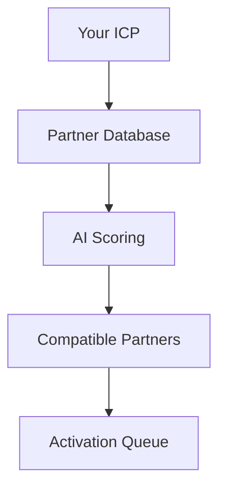

## Overview

GTM Fabric empowers you to build predictable partner revenue through advanced ecosystem analysis and orchestration. Key features include `Ecosystem Intelligence` for partner mapping, `Signal Intelligence` powered by AI, `Actionable Insights` for decision-making, and `Activation Services` for seamless partner engagement.

<Columns cols={2}>
  <Card title="Ecosystem Intelligence" icon="network" href="/docs/ecosystem-intelligence">
    Map and analyze your entire partner ecosystem in real-time.
  </Card>
  <Card title="Signal Intelligence" icon="zap" href="/docs/signal-intelligence">
    Harness technographic and intent signals with AI processing.
  </Card>
  <Card title="Actionable Insights" icon="bar-chart-3" href="/docs/actionable-insights">
    Generate prioritized opportunities from data.
  </Card>
  <Card title="Activation Services" icon="rocket" href="/docs/activation-services">
    Automate workflows to activate partners efficiently.
  </Card>
</Columns>

## Ecosystem Intelligence

Ecosystem Intelligence provides a comprehensive view of your partner network. You identify ideal partners, assess compatibility, and track relationships using graph-based analysis.

<Callout kind="info">
  Start by connecting your CRM and partner data sources to populate the ecosystem graph.
</Callout>

This feature uses AI to score partner fit based on ICP alignment, technographics, and historical performance.



## Signal Intelligence and AI Tools

Signal Intelligence aggregates intent data, technographics, and behavioral signals. AI tools process this into predictive models for partner selection.

<Tabs>
  <Tab title="Intent Signals" icon="search">
    Track buyer intent across your ecosystem.
    
    ```javascript
    const signals = await fetch('https://api.example.com/v1/signals/intent', {
      headers: { Authorization: `Bearer ${YOUR_API_KEY}` }
    });
    ```
  </Tab>
  <Tab title="Technographics" icon="database">
    Analyze tech stacks for compatibility.
    
    ```python
    import requests
    response = requests.get(
      'https://api.example.com/v1/signals/techno',
      headers={'Authorization': f'Bearer {YOUR_API_KEY}'}
    )
    ```
  </Tab>
</Tabs>

## Actionable Insights Generation

Transform raw signals into prioritized insights. You receive dashboards with joint ICP matches, revenue potential scores, and activation recommendations.

<CodeGroup tabs="Dashboard API,Webhook">
  ```javascript
  // Fetch insights
  const insights = await fetch('https://api.example.com/v1/insights', {
    method: 'POST',
    body: JSON.stringify({ ecosystemId: 'ecm_123' })
  });
  ```
  ```bash
  # Webhook for real-time insights
  curl -X POST https://your-webhook-url.com/insights \
    -H "Authorization: Bearer YOUR_TOKEN" \
    -d '{"event": "new-insight", "data": {...}}'
  ```
</CodeGroup>

## Activation Services Walkthrough

Follow these steps to activate high-potential partners.

<Steps>
  <Step title="Select Partners" icon="users">
    Review insights dashboard and select top matches.
  </Step>
  <Step title="Generate Playbooks" icon="book-open">
    Auto-generate co-marketing and sales playbooks.
  </Step>
  <Step title="Orchestrate Outreach" icon="send">
    Launch automated workflows via email/Slack integrations.
  </Step>
  <Step title="Track Performance" icon="trending-up">
    Monitor engagement and revenue attribution in real-time.
  </Step>
</Steps>

<Expandable title="Advanced Activation Scenarios" default-open="false">
  For enterprise-scale activations, integrate with your CRM for bidirectional sync.
  
  <ParamField path="ecosystemId" param-type="string" required="true">
    Your ecosystem identifier.
  </ParamField>
  
  <ParamField query="priority" param-type="number" required="false">
    Filter by score `{>80}` for top partners.
  </ParamField>
</Expandable>

<Board title="Partner Activation Pipeline">
  <BoardColumn title="Qualified" color="1" icon="check-circle">
    <BoardCard title="Partner A" description="ICP match 92%" icon="zap" dueDate="2024-12-15" author="Sales Team" />
    <BoardCard title="Partner B" description="Tech stack aligned" icon="shield" />
  </BoardColumn>
  <BoardColumn title="Activating" color="3" icon="loader">
    <BoardCard title="Joint ICP Workshop" description="Schedule Q1 session" dueDate="2024-12-10" />
  </BoardColumn>
  <BoardColumn title="Active" color="2" icon="trending-up">
    <BoardCard title="Partner C" description="Pipeline $500K" createdAt="2024-11-20" />
  </BoardColumn>
</Board>

<Callout kind="tip">
  Customize thresholds in your settings for optimal results. Monitor via the dashboard at `https://dashboard.example.com`.
</Callout>